# iOS 美区 Apple ID 注册与付款方式

想在 App Store 下载国区没有的 App，或者买美区的付费软件，都需要一个美区 Apple ID。
本文记录从注册美区 ID，到用支付宝买礼品卡充值的完整流程。

!!! note "开始之前"
    - 一个没注册过 Apple ID 的邮箱（推荐 Gmail / Outlook，不建议 QQ 邮箱）
    - 一个能收短信的 +86 手机号
    - 一台 iPhone（换区和兑换礼品卡都要用到）

## 一、注册 Apple ID

1. 浏览器打开 <https://account.apple.com/>，在页面右上角找到 **Create Your Apple Account**，开始创建账号。

2. 地区选择 **United States**，出生日期满 18 岁即可。

3. 邮箱填一个没注册过 Apple ID 的，最好用 Gmail 或 Outlook，不要用 QQ 邮箱。最下面的手机验证选 **+86**，填自己的手机号。

    !!! warning "密码要求"
        密码不要包含姓名、手机号，要有大小写字母、特殊字符和数字。

4. 分别通过填写的邮箱和手机号完成验证，ID 就注册好了。

5. 补充地址信息。登录后，在网页左侧点 **Payment and shipping**（付款与配送）→ **Add a shipping address**（添加收货地址）：

    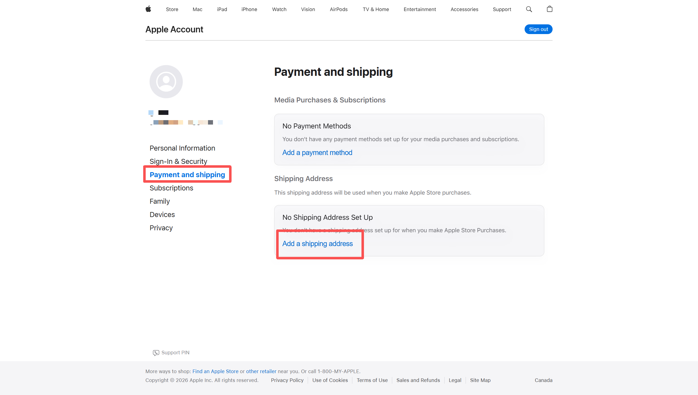

    完善地址之后，购买付费软件时才不会卡在结算页。

    - 地址可以用 [usaddressgen.com](https://usaddressgen.com) 或 [shenfendaquan.com](https://shenfendaquan.com) 这两个网站生成。
    - 州建议选免税州：**俄勒冈（Oregon）、特拉华（Delaware）、蒙大拿（Montana）、阿拉斯加（Alaska）**，可以避免后续收取销售税。
    - 邮箱用自己填的那个，或者用网站随机给的都行。

## 二、在 iPhone 上切换到美区账号

注册好之后，**不建议直接在「设置」里用新账号登录整台手机**，很容易被封号。正确做法是只把「媒体与购买项目」换成美区账号，iCloud 保持原来的账号。

1. 打开「设置」，点最上面的 Apple 账户：

    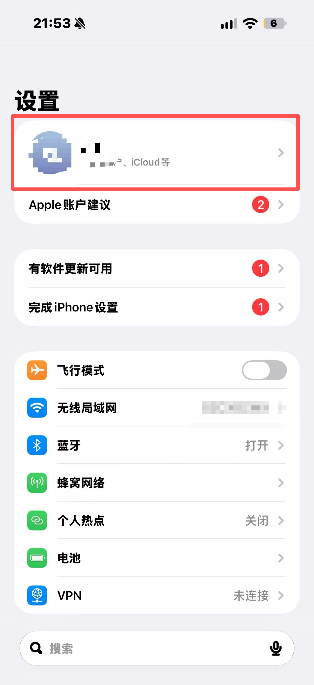

2. 进入后点「媒体与购买项目」：

    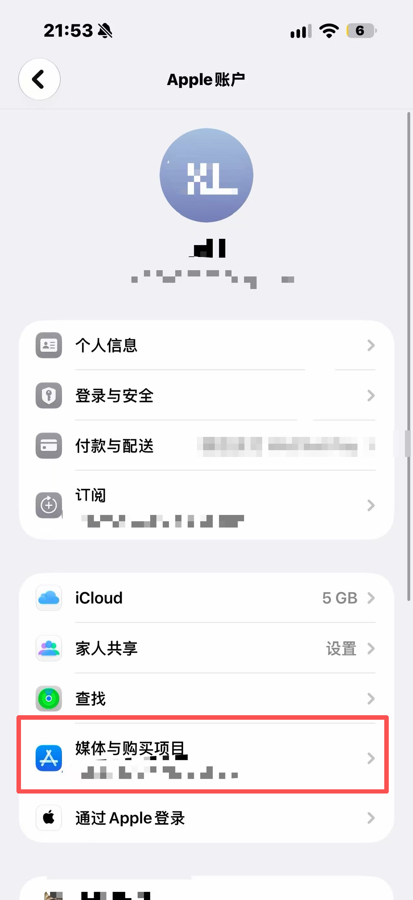

3. 在「账户设置」页滑到最下面，点「退出登录」：

    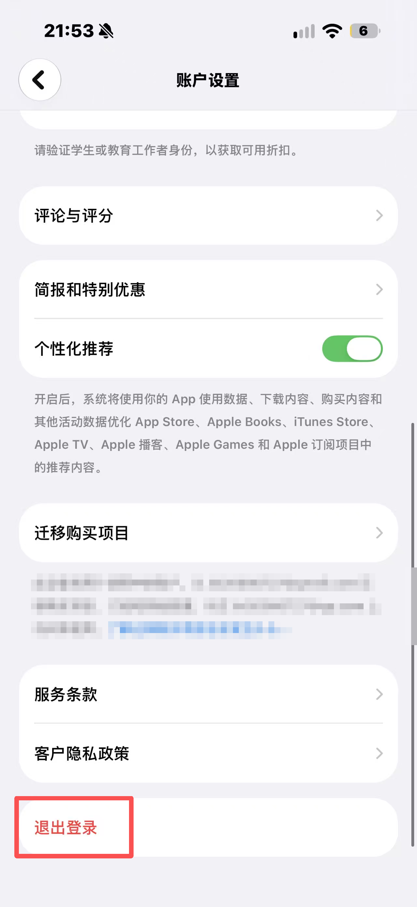

4. 打开 App Store，点右上角的头像：

    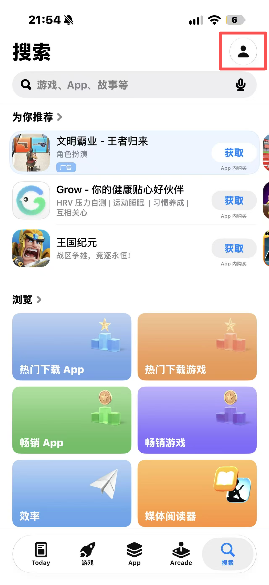

5. 点「Apple 账户登录…」，登录刚注册好的美区账号：

    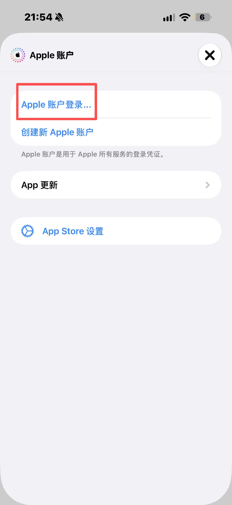

6. 弹窗问「以某某身份设置媒体与购买项目?」时，**不要点「继续」**（那会把媒体与购买项目绑到当前这个 iCloud 账号上），选下面那个换其他 Apple 账户的选项（图中红框处），再登录刚注册的美区账号：

    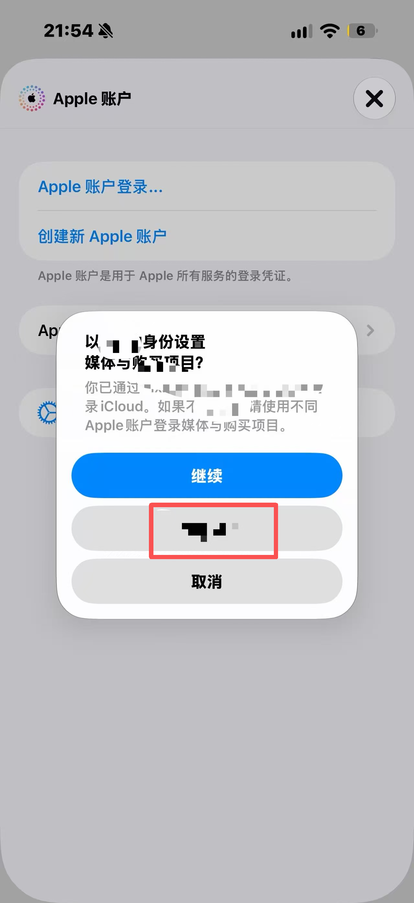

这样 iCloud 还是原来的账号，只有 App Store 走美区，不容易触发风控。

## 三、没有 Visa 卡怎么买付费 App

思路很简单：用支付宝买美区 Apple Gift Card（礼品卡），拿到兑换码后在 App Store 兑换，账户里的美元余额就能直接用来买 App。

1. 打开支付宝，左上角把地区改成**旧金山**，回到首页右滑找到「支付宝 AI」，输入「打开 pocket shop」，授权后点开 PockytShop 小程序：

    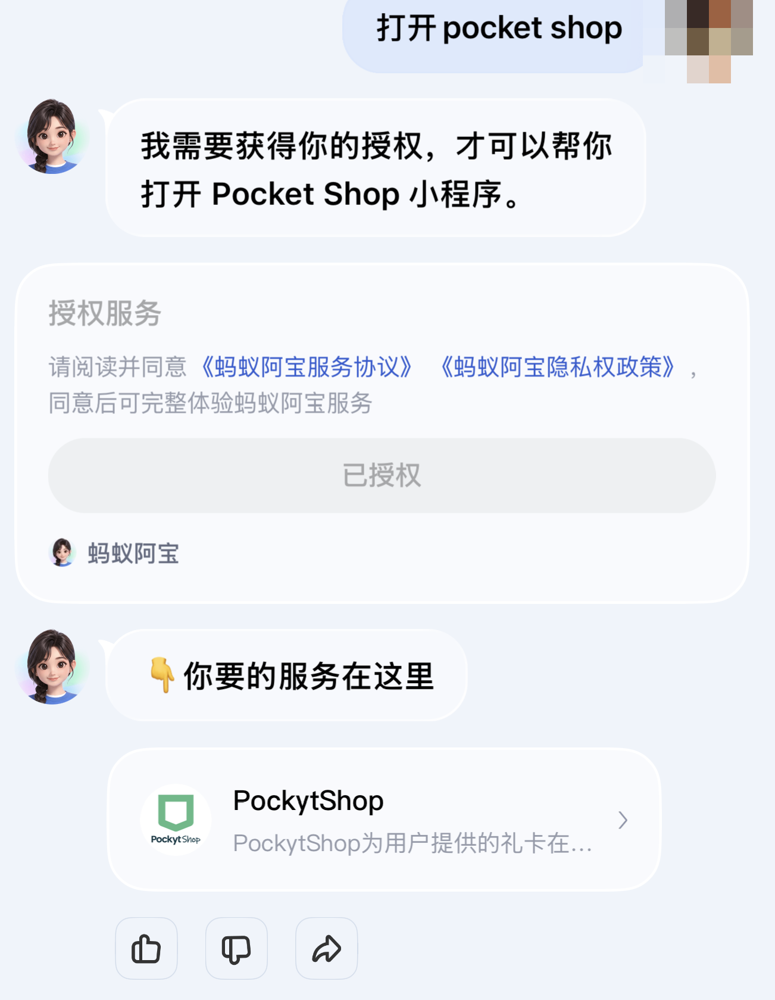

2. 进入 PockytShop 后地区选**美国**，点 **Apple Gift Card**：

    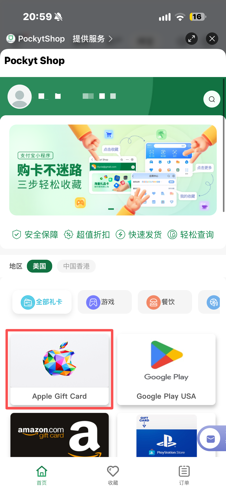

3. 选择需要的金额下单，没有合适的额度就等补货：

    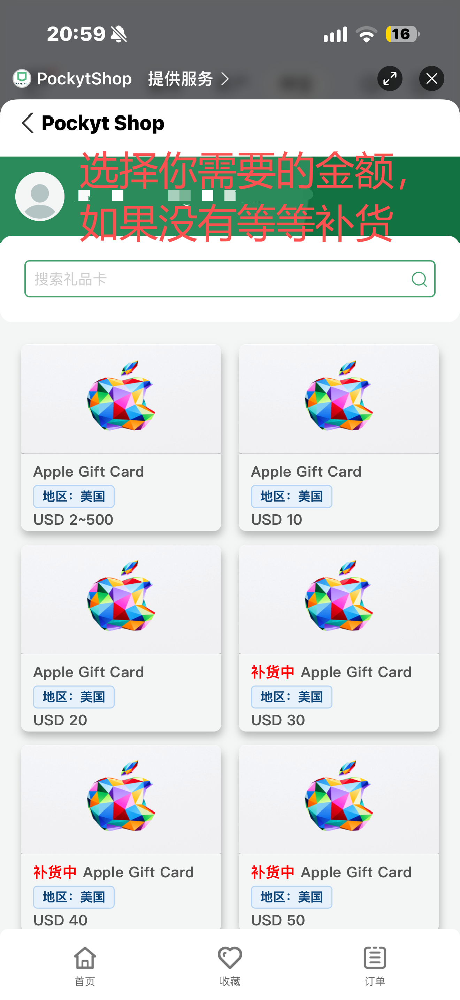

    初次进入需要注册一个 PockytShop 账号，自己注册就行。付款后会得到一串兑换码，**记得复制**。

4. 回到 App Store，点右上角头像，最下面选「兑换代码」：

    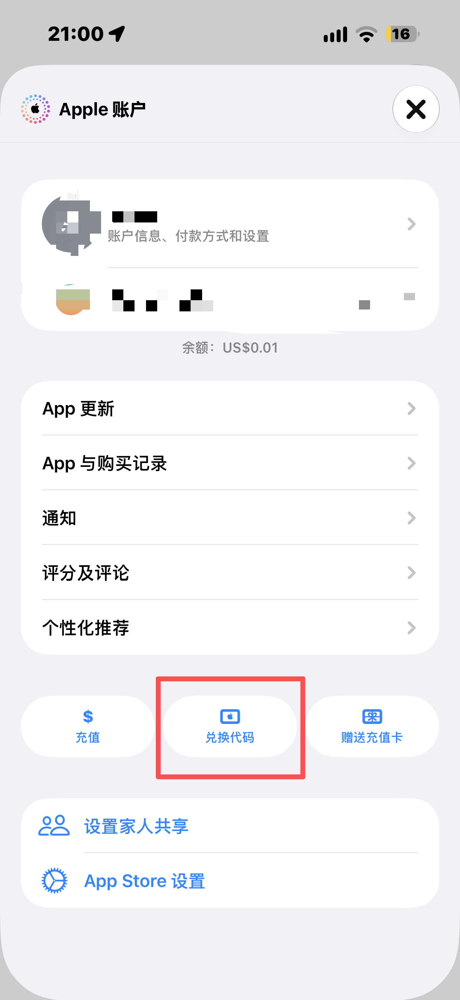

5. 点「手动输入兑换码」，把刚才复制的代码粘进去就兑换好了：

    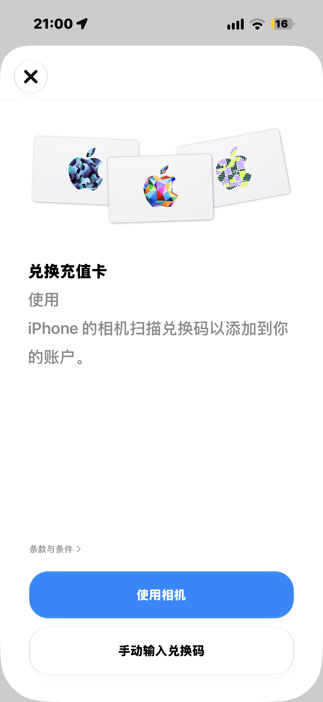

兑换成功后账户里就有美元余额，可以直接买 App 或者内购。

## 注意事项

- **别在系统设置里直接登录新号**。只在 App Store 的「媒体与购买项目」里登录，iCloud 保持原账号，否则很容易被封。
- **密码别用姓名、手机号**，要大小写字母、特殊字符、数字都有。
- **注册邮箱最好别用 QQ 邮箱**，Gmail、Outlook 的成功率更高。
- **地址选免税州**，能省掉后续的销售税。
- 新号建议先放几天再消费，不要在刚注册完就大额购买。
